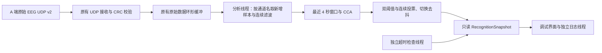

# B 端第二阶段：连续滤波与 CCA

2026-10-19。本地分支 `codex/b-stage2-cca`，起点为第一阶段提交 `b7eaf03cf632a920cbb9bd65b089c349e779e055`。团队共享仓库未参与此次开发。只实现软件识别结果，不发送轮椅或 Unity 运动指令。

**真实 EEG 分类准确性尚未验证。默认阈值只用于合成信号调试，不是标定结果，也不构成真实轮椅安全验证。**

## 数据与模块



- 复用 `receiver/EegProtocol.kt`、`UdpReceiver.kt`，线协议没有修改。`StreamSession` 增加健康状态和选定通道的增量读取，不另建接收协议。
- 通道按 `STREAM_INFO` 名称精确匹配：`Pz,O1,Oz,O2,P1,P2,POz,PO3,PO4`。名称不足时停止；不假定固定通道下标。
- `signal/Bandpass.kt`：Double 精度、因果 4–45 Hz Butterworth、最终四阶 / 两个 SOS，DF2T；每通道独立状态跨包延续。支持 100–4000 Hz；新流、缺包或缓冲覆盖后重置，先舍弃 0.5 秒预热数据，再积累 4 秒。
- `signal/Cca.kt`：四频率分别构建 1/2/3 次谐波的 sin/cos 参考；EEG 与参考按列去均值。用带列主元的两遍正交化处理秩亏，求交叉子空间矩阵的最大奇异值，得到标准 CCA 第一相关值。不使用发送端标签、不用 FBCCA 或正则化改造。
- 方向顺序为前进 12.00、左转 8.57、右转 6.67、后退 5.45 Hz。内部枚举不是 B→Unity 指令编号。
- `signal/SignalEngine.kt`：单独线程读取增量、连续滤波、计算；每轮结束后延迟 200ms，只有新样本满 200ms 才判决。独立 50ms 超时检查；消费者读取结果时也检查。CCA 与磁盘日志均不在 UDP 接收线程内执行。
- `signal/DecisionGate.kt`：最高相关值严格超过绝对阈值，且第一与第二名差值严格超过差值阈值。随后要求连续同方向窗口投票和等待去抖时间；切换期间先停止，无可靠判决立即停止，不保留旧方向。
- 调试默认值：绝对阈值 **0.65**、差值 **0.15**、连续 **3** 窗、去抖 **300ms**。界面可改，参数改变立即停止并重投票；仅保存于进程内，重启恢复默认值。不是沿用 0.57/0.245，也不是证明新值适用于真实 EEG。
- 新流最快约 4.5 秒产生首个原始判决，再等待投票；默认稳定方向约 4.9 秒或更长。方向变化受到 4 秒滑动窗口影响。200ms 是更新目标，不是首次识别时延；不承诺旧 PRD 的 300ms。

## 停止与接口

`RecognitionSnapshot` 提供四分数、门控后原始判决、稳定判决、停止原因、当前参数、窗口末样本号、判决时间及计算开销。`configure(RecognitionConfig)` 是参数入口；后续 UI 可以替换而无需改算法。只有 `stable` 适合作为后续安全控制层的候选输入；本阶段并不包含完整急停锁止或运动控制层。

STOP、断流超时、缺包、换流、缺通道、无效采样率、原始缓冲覆盖、窗口不足、数值异常、低相关/差值不足均保持或进入停止。判决超过 1 秒未更新也停止，即使 UDP 仍收到数据。超时清空原始会话，恢复需新的 `STREAM_INFO`；在途的旧代次/旧配置计算结果不能恢复运动判决。50ms 为检查调度间隔，不能作为真机最坏停止时延保证。

日志：应用私有 `files/stage2-status.json` 为最新状态，`files/stage2-trace.csv` 最多 6000 行；重新启动监听覆盖此轮诊断文件。日志仅记录结果，不参与分类。复制日志按钮包含识别状态。

## 构建与复现

本机使用已有 JDK17、SDK35、Gradle8.11.1。为独立数值对照创建了 `D:/BrainChair/stage2-test-env` 测试虚拟环境：Python3.14、NumPy2.5.4、SciPy1.18.1；未改全局 Python 或 PATH，Android App 不依赖 Python。

```powershell
powershell -ExecutionPolicy Bypass -File .\scripts\build-stage2.ps1
& 'D:/BrainChair/sdk/platform-tools/adb.exe' -s emulator-5554 install -r .\output\stage2\BrainChair-B-stage2.apk
& 'D:/BrainChair/stage2-test-env/Scripts/python.exe' .\scripts\verify_stage2_android.py
```

后两步需要已启动的 `BrainChair_API35` 模拟器（emulator-5554）。脚本使用模拟器 UDP 转发 19000→9000、19001→9001，不等同于真机 Wi-Fi 广播验证。运行时会停止并重新启动测试 App，覆盖本轮诊断日志。

构建脚本先生成独立 SciPy 测试数据，再同步至 `D:/BrainChair/build-stage2` 离线构建、单元测试与 Lint。输出在忽略提交的 `output/stage2/`；第一阶段和旧原型 APK 路径不变。其他电脑需自行配置路径和测试依赖；直接运行 Gradle 前需用 `stage2_oracle.py --output test-fixtures/stage2` 生成测试数据。

## 文档冲突与待确认事项

| 项目 | 本阶段处理 | 状态 |
|---|---|---|
| A 发意图/置信度与 A 发原始 EEG | 继续按冻结 UDP v2 接收原始 EEG，B 自行滤波/分类 | 用户已确认 |
| 手册“四阶、2 SOS”与 Python `butter(4, bandpass)` | 明确使用最终四阶、2 SOS（相当于 SciPy `butter(2, ...)`）；后者实际最终八阶、4 SOS | 实现选择已记录；真实数据效果待对比 |
| 手册参考阈值 0.57/0.245 | 不移植；当前可配置调试值需重新标定 | 真实数据标定待做 |
| 不可靠判决保持旧方向等旧示例 | 按本轮要求立即停止，切换时先停止 | 用户本轮要求优先 |
| 300ms 与 4 秒窗口 | 200ms 更新周期不代表 300ms 识别时延 | 课程指标待小组修订 |
| 手动/急停/蓝牙/Unity | 保留旧代码，本阶段不接入新识别链路 | 后续安全层、协议与验收范围待确认 |

滤波器阶数依据：[SciPy butter 官方说明](https://docs.scipy.org/doc/scipy/reference/generated/scipy.signal.butter.html)。CCA 数值对照独立使用 SciPy `orth`/`svdvals`；相关子空间计算说明：[SciPy subspace_angles](https://docs.scipy.org/doc/scipy/reference/generated/scipy.linalg.subspace_angles.html)。原输入资料仍保留在 `docs/stage1/sources/`。

## 下一步联调材料

需要 A 端当前 APK/版本、实际 STREAM_INFO 与原始 UDP 抓包、OpenBMI 原始回放片段及离线试次标签/刺激开始结束时间、采样率/单位/预处理信息、真实静息和低质量数据、训练标定与独立测试划分。标签只能用于离线评估，不能送入识别器作为控制依据。

还需 Android 真机及同一局域网进行广播、前后台、断网恢复及性能验证。Unity 端口/指令/急停语义仍需负责人确认。四方向合成信号成功不能替代跨被试准确性、误触发率、真实静息拒识和载人安全验证。
