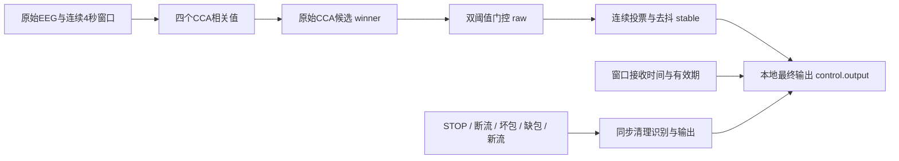

# Stage 2.6：识别停止逻辑修复与验收

2026-10-19。分支 `codex/b-stage26-safety`，基线为 Stage 2.5 的 `1fed131`；Stage 1 `b7eaf03`、Stage 2 `467f106` 和 Stage 2.5 均保留。团队共享仓库未修改、未推送。

**结论：停止状态处理与过期结果处理已修复并通过回归；完整识别安全验收仍失败。** 静息拼接误动和无STOP切换的旧方向输出不是通过修改阈值消除的。本次未修改滤波器、CCA、频率映射、阈值、4秒窗口、三窗投票或300ms去抖。候选0.55/0.05仍仅作诊断，App默认仍为0.65/0.15，两者均未获得安全验收批准。

## 1. 根因及修复

| 问题 | 核对结果 | 本次处理 |
|---|---|---|
| 无可靠判决后是否保留旧方向 | 原DecisionGate遇门限失败即reset；候选换方向时先STOP；不是投票器无条件维持旧方向 | 保留；补充最终输出断言 |
| STOP后的状态清理 | 原StreamSession立刻清会话，但SignalEngine内部状态等到snapshot读取/50ms检查才失效；原读取API已有兜底 | 新增同步会话失效通知，在accept(STOP)返回前清空识别和本地输出 |
| 当前来源CRC错误 | 原版只计数拒收，在下一次连续性/超时检查前可能继续保留原判决 | 立即废弃当前窗口并同步STOP；必须重建预热和完整窗口 |
| 迟到的计算结果 | 原版用计算完成时间作为新鲜度；测试中计算耗时1.2秒、同时继续收包时，旧窗口仍能被发表为新判决 | 以窗口末样本在B端接收时间计有效期，过期结果丢弃；最终输出有效期最多到该时间+1秒 |
| 静息拼接的2个后退误动 | 分数确实满足候选阈值且通过投票，并非旧状态未清除 | 仍保留失败记录，不冒充已修复 |
| 无STOP更换波形残留方向 | 窗口仍包含旧方向样本，CCA仍可信地选择旧方向；输入没有可用于立即识别切换的事件 | 未用标签或短窗替代识别；失败继续计入最终输出指标 |

同步通知同样用于有效新INFO、缺包、显式停止监听和断流超时；错误通道布局、时间戳、停止序号也会废弃当前窗口。外部其他来源的错误报文不使当前有效来源失效。冻结的UDP v2包格式、CRC算法、发现和收包线程实现均未修改。

新回调只更新内存状态，不在UDP线程执行滤波、CCA、文件IO或网络发送。修复还保留代次/配置版本检查，STOP或换流期间计算中的旧结果不能重新恢复输出。

## 2. 四个层次与接口



- `winner`：argmax候选，不代表可靠方向；即使静息也可能有最大值。
- `raw`：通过双阈值后的方向，未通过为STOP。保留字段名以兼容旧诊断。
- `stable`：经过投票、去抖的识别结果，候选切换时先STOP。
- `control.output`：独立本地最终输出；要求raw与stable一致且窗口仍新鲜，否则STOP。这个层仍无法知道一个“高相关但错误”的识别结果是否符合真实意图。

`RecognitionControl.kt`集中定义最终状态；`controlSnapshot()`是后续控制消费者的读取入口，包含超时检查。`eventSnapshot()`只用于审计同步事件，不作为可以绕过时效检查的控制接口。读取返回的历史快照不能永久缓存作控制依据。

**目前没有Unity/蓝牙/电机输出**，也未实现下一阶段完整人工优先级与急停锁止。这里的“最终”仅指识别模块本地控制输出，不能等同于轮椅已经停车。UI和日志补充四层状态、输入时间、有效期、停止原因和输出版本号。

## 3. 修复前后对照

将Git基线导出到独立构建目录，与修复版运行同一份可移植测试，不修改旧分支。注入分数的生命周期探针与真实EEG回放分开统计。

| 探针 | 修复前 | 修复后 |
|---|---|---|
| 有效STREAM_STOP返回后、不主动读取状态 | 内部仍为前进；经原snapshot读取才停止 | 同步停止 |
| 当前来源CRC错误 | 经snapshot读取仍为前进 | 同步停止并重建窗口 |
| CCA耗时1.2秒、期间输入仍新鲜 | 旧窗口发表为前进 | 丢弃并停止 |
| 缺包、新INFO、超时事件 | 内部状态等待读取检查 | 同步停止 |
| 无可靠分数、方向候选切换 | 已能停止 | 识别与最终输出均断言停止 |

这不是宣称原版曾向硬件发出错误指令：旧版没有硬件输出，其snapshot也有STOP兜底。本次消除的是内部失效传播滞后，并补上原来实际可读出的CRC/过期计算风险。

31项JUnit测试最终通过，包含原阶段回归、同源坏包/异源坏包、STOP、缺包、断流、新流、过期计算、投票切换、低置信度、NaN和最终有效期。旧卡住CCA测试的原因文案因新鲜度检查提前触发而变化，已改为同时断言稳定状态和最终输出为STOP；没有放宽安全条件。构建及Lint通过，保留原有3条Lint警告。

已安装实际APK执行Android模拟器检查，详细性能、停止观测和仍失败的转静息路径见 [ANDROID.md](ANDROID.md)。

正常波形回放中，修复前后每条CCA分数、门控、稳定判决与最终输出对照**完全相同**。这验证修复未悄悄改分类成绩，也意味着分类问题并未由状态机修复解决。

## 4. 验收口径及结果

未进行新的阈值调参；旧Stage 2.5标定测试仅复跑回归，不作为新的标定或外部验收。沿用Stage 2.5已冻结的原始试次划分：每类前2个运动试次+第一段静息为原标定集，其余8个运动试次+第二段静息为历史评价集。这些数据已经看过，**不能称为新的独立评价集**。

主要统计单位改为原始试次，不把重叠窗口当成独立样本：

- 单独4秒试次：8/8评价运动试次均无输出，原因是窗口不足；静息1/1保持停止。这是启动限制，不能包装为分类成功。
- 同一试次重复3次提供12秒输入：仍只计原试次1个单位。默认参数下7/8运动试次至少出现正确输出且无错误方向，1/8后退试次完全拒识；候选下8/8至少出现正确输出。**“至少出现一次”不是全程可用率。**
- 重复试次的有效运动窗口中，默认停止205/304（67.43%），候选停止130/304（42.76%）；这些仅作覆盖率诊断。完整逐试次记录保留首次判决、正确/错误/停止次数。
- 完整静息两段拼接时，候选仍有2个后退误动窗口；默认在该特定场景为0。无STOP方向切换时默认仍有11个错误运动窗口，候选17个，候选转静息还有6个误动窗口。

失败规则明确为：**任何最终输出的静息误动或方向错误，都不能通过本阶段对应安全场景验收。** 不因门控拒识很多、其他方向没错或测试程序执行成功而豁免失败。

完整5×5矩阵（含停止列、静息行）、逐试次拒识率、修复前后结果见 [RESULTS.md](RESULTS.md)。四层窗口混淆矩阵见 [layer-matrices.json](layer-matrices.json)，全部误动见 [errors.csv](errors.csv)，逐试次见 [trials.csv](trials.csv)。完整逐窗口记录放在本地 `output/stage26/before/` 与 `after/`，可通过脚本重算。

## 5. 停止及切换延迟

离线模型200ms调度，以下是本批固定回放的观察，不是真机最坏上限：

| 路径 | 默认0.65/0.15 | 候选0.55/0.05 |
|---|---|---|
| 前进稳定运动→静息，无STOP | 1.2秒后持续停止；此前5个错误运动窗 | 1.6秒后持续停止；此前7个错误运动窗 |
| 前→左，无STOP | 首次停止1.0秒；首次正确稳定左3.8秒 | 首次停止1.2秒；稳定左3.2秒 |
| 左→右，无STOP | 首次停止1.0秒；稳定右3.8秒 | 首次停止1.4秒；稳定右3.4秒 |
| 右→后，无STOP | 首次停止0.8秒；稳定后4.2秒 | 首次停止1.4秒；稳定后3.4秒 |
| 有效STOP，再新INFO | STOP处理返回前本地状态清空；新流必须重新累积 | 同样处理 |

特意追加了“确实正在前进→静息”场景。另一条“后退→静息”回放在边界时本来已经STOP，不能用它的200ms首次STOP冒充运动中的停车响应。候选在那条路径还会先停止、再误动，直到1.6秒后才持续停止。报告同时保留首次停止和持续停止，避免挑选好看的时间。

初次输出延迟的构成：0.5秒滤波预热 + 4秒完整窗口 = 4.5秒，按200ms分析调度本测试首窗为4.6秒。三窗投票在连续可靠时再等待2×200ms=400ms；300ms去抖与投票并行，第三票时已满足，**不应再额外相加300ms**。理想连续支持下首次稳定约5.0秒。

右转/后退出现7–12秒或完全无输出，主要额外时间来自分数未过门限、连续票数被重置。例如默认评价试次14首次门控通过在4.6秒，首次稳定却到8.4秒；试次15在12秒内没有通过。不能取消拒识来缩短这些时间。

## 6. 为什么方向表现不同

实测四方向首次对齐窗真类ρ均值依次约0.7592、0.7854、0.7285、0.6623。后退在原始对齐试次上本就较弱；16个运动试次的对齐最大值仍对应正确频率，没有发现左右/前后映射交换。

全部试次混合滑窗的真类ρ中位数依次约0.7607、0.6800、0.6081、0.5183。跨不同试次/硬回绕窗口下降明显，后退和右转更容易触发拒识并打断投票。单试次重复与多试次拼接不是相同输入分布，不能只挑前者的好结果。

连续滤波初始对齐窗与第三遍对齐窗的同试次最大ρ差异约0.012–0.037，说明滤波状态确实有影响，但不足以独自解释较大的跨试次滑窗变化。没有发现每包误重置滤波器：原有跨包、独立SciPy数值对照测试仍通过。

滤波器在12、8.57、6.67、5.45Hz的幅值增益约1.000、0.996、0.971、0.911；后退基频更靠近4Hz边缘。不过CCA对统一缩放不敏感，不能直接把9%的幅度衰减说成9%的相关下降，真实谱与噪声结构也有影响。这是机制分析，不是已经证明的单一病因。

在不改窗长和安全规则的前提下，本次没有发现可以仅靠状态机提高识别率的可靠办法。进一步的特征/参考或滤波改动需要新的独立数据评价，不应在这18段已知材料上反复调到通过。连续真实数据或更长的独立试次也能减少人为拼接的影响，但不能偷偷平滑/改写当前资产来抹掉测试失败。

## 7. 工程与复现

新增：`RecognitionControl.kt`、`RecognitionControlTest.kt`、`SafetyRegressionProbeTest.kt`、`TrialSafetyReplayTest.kt`、本阶段构建/统计/Android脚本和文档。

修改：`StreamSession.kt`同步失效通知；`SignalEngine.kt`窗口时效与最终状态；`RecognitionTrace.kt`日志；`ReceiverActivity.kt`简单状态文字；`SignalTest.kt`超时回归断言；Gradle版本更新为`0.3.1-stage26`/versionCode3。未修改`EegProtocol.kt`、`UdpReceiver.kt`、`Bandpass.kt`、`Cca.kt`或`DecisionGate.kt`。

```powershell
powershell -NoProfile -ExecutionPolicy Bypass -File .\scripts\validate-stage26.ps1
& 'D:/BrainChair/stage2-test-env/Scripts/python.exe' .\scripts\stage26_report.py
& 'D:/BrainChair/sdk/platform-tools/adb.exe' -s emulator-5554 install -r .\output\stage26\BrainChair-B-stage26.apk
& 'D:/BrainChair/stage2-test-env/Scripts/python.exe' .\scripts\verify_stage26_android.py
```

基线使用Git archive导出至 `D:/BrainChair/build-stage26-before`，修复版构建于 `D:/BrainChair/build-stage26-after`；旧工作分支/旧输出目录不覆盖。`-SkipBaseline`只适用于基线结果已存在的本地回归。复用已有开发环境，不安装新工具。

APK、原始数据和完整诊断输出保留在忽略提交的`output/stage26/`；小型错误/试次/对照证据随源码提交。APK仅用于软件调试，不作为实机轮椅安全版本。

## 8. 尚未通过与手机联调前确认

仍未通过：候选静息拼接误动、默认与候选的无STOP切换、足够的后退/右转可用覆盖率、短按4秒识别、独立新数据/跨被试安全评价。不能仅靠当前数据证明实际使用安全；不提供已验收阈值。

A/B手机联调前需确认：A在松手、切方向、应用退出和发送异常时是否实际发送有效STOP；抓包验证顺序、最后样本号、来源端口和新INFO；明确没有STOP的异常路径不得假定能立即识别意图变化。真实运动转静息不依赖松手时的拒识安全也需继续评估，不能靠A按钮标签替代。

还需新采集/导出的长静息、连续方向转变数据、原始刺激时标与单位说明，以及真机前后台、断网、乱序、丢包、省电、CPU/内存和长时误触发测试。未来控制接口只能消费带有效期的最终输出，必须继续落实独立人工停止/急停设计。Unity、蓝牙和真实轮椅仍未接入。
