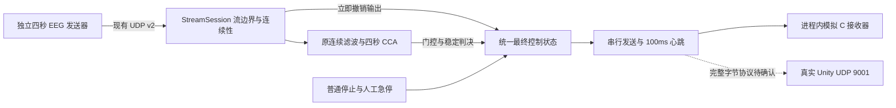

# Stage 2.7：四秒流切换、最终控制与停止闭环

本阶段保留原工程，在 `codex/a4s-switch-stop-integration` 开发，基线为 `3a35592`。没有改写 A APK、冻结的 v2 字节协议、团队仓库或既有阶段产物，没有推送远程。

**交付结论：B 的流切换、最终 STOP 和急停链路已实现并测试；四秒点击不能产生有效运动时间，真实 Unity UDP 仍受协议细节缺失阻塞。** 这些限制没有通过缩窗、延后 STOP、标签识别或放宽阈值掩盖。

## 实现及数据流



- 每个有效 INFO 都是保守的新流边界。清空 EEG 缓冲、滤波/分析窗口、投票、去抖和输入/判决时效；新流重新预热并积累，不拼接不同流的数据。
- STOP 同步撤销最终运动状态、清空分析状态并唤醒独立发送线程。发送线程每次读取当前最终状态，队列只存唤醒请求，不存旧方向。计算中的 CCA 用代次和失效令牌检查，STOP 或新 INFO 后不能发布旧运动。
- CRC/通道/时间戳错误、缺包、窗口失效、输入或判决过期均撤销运动。重复和已退休流的数据被忽略；新流必须看到有效首包。丢失首包时保持停止，等待新 INFO/有效起点，不用后续数据假装完整开头。
- 最终命令单独定义为前进、后退、左转、右转、STOP、ESTOP。CCA 候选顺序与命令编号分离。新草案映射为 `01/02/03/04/05/06`；旧原型的 `ESTOP=07` 不进入新链路。
- 普通人工停止保持到下一次新流。人工急停独立锁定，并持久化，跨停止监听/进程重启保留。普通停止、流 STOP、新 INFO 都不解锁。解除必须人工操作、模拟接收端静止且链路在 500ms 内有效，解除后仍 STOP，必须开始另一条新流。
- 原 Bandpass、Cca、DecisionGate 未改写。保留 0.5s 预热、4s 窗、约 200ms 更新、三窗投票、300ms 去抖以及默认 `0.65/0.15`。默认不是通过真实 EEG 标定的参数；没有把旧候选 `0.55/0.05` 宣布为合格。
- 调试页和私有 JSON 分开显示 CCA 候选、门控原始判决、稳定判决、最终允许指令、模拟发送和模拟接收。真实 Unity 接收始终标为未验证。

## 实测结果与四秒矛盾

最终构建与原始测试摘要见 [evidence.json](evidence.json)、[RESULTS.md](RESULTS.md)；同一时钟下的实际 UDP 时间线见 [udp-timeline.csv](udp-timeline.csv)。这里只统计本阶段测试，没有重用旧测试数量充当新成果。

四秒点击流发送 4000 点，原算法先舍弃 500 点预热，剩余 3500 点不足 4000 点分析窗，因此 **CCA 分析次数为零，没有原始/稳定运动判决，也没有运动命令先于 STOP**。快速换向又会重新开始积累，不能增加可用窗口长度。真实 EEG 片段与合成信号都不改变这一时间约束。

另设的六秒合成诊断流只用于测量未修改算法的启动时间、证明完整计算与控制链路能工作。它不是四秒交互的通过示例，也不代表真实 EEG 分类准确性。该诊断经过实际因果滤波、CCA、阈值、投票和去抖，没有注入分类标签或替代相关值。

本阶段测试证明四秒流程安全地保持停止，**没有证明 Unity 能观察到轮椅运动**。需产品层面共同决定四秒发送周期、四秒分析窗口、预热/投票以及“结束立即停止”之间如何取舍。本阶段没有代替小组作决定。

时间口径：

- JVM 实时测试使用实际本地 A→B UDP；发送器、B 和模拟 C 共用 `System.nanoTime`，分别记录源端 STOP 发送、B 收包/撤销、模拟发送、模拟接收。
- Android 使用 B 进程内部同一个单调时钟记录 INFO 接受、判决、STOP 接收和模拟发送/接收。没有相减电脑与模拟器的时钟冒充单向网络延迟。
- `STOP` 最终状态可能先于全部分析清理回调完成被发送，因最终控制撤销监听器优先执行；这符合停止优先设计。
- 所有时延都是本次测试的观测值，不是实际 Wi-Fi、真实 Unity 渲染或真实轮椅制动的上界。

## Unity 的完成范围与阻塞项

已完成统一接口、六命令映射、速度范围校验、STOP/ESTOP 的零速度、变化发送、100ms 心跳和独立模拟接收器。模拟运动速度暂为 30（0～100 范围），真实速度字节和物理速度映射未确认。模拟 C 独立保留急停锁定，1s 无合法模拟命令时停止运动，只有显式人工解除才解锁。

**B→C 未发送真实 Unity UDP，也未验证 Unity 实际接收或停车。** 本地工程、团队克隆目录和可见资料没有找到当前 Unity 接收 C#。旧 7 字节原型帧、旧 `47F0/9100` 草案都没有当成最新兼容实现。

本次最新已知值：UDP 控制 9001，帧头 AA55/帧尾 0D0A，方向和 STOP/ESTOP 编号如上，速度 0～100，状态回传可选 9002。仍须 Unity 负责人提供：

1. 类型字段的取值和宽度，长度字段的宽度、字节序及所计范围。
2. 数据字段里命令与速度的顺序、字节数、速度编码。
3. 校验算法与覆盖范围，至少一组完整合法 STOP、ESTOP、运动帧。
4. Unity 接收脚本及急停人工解除/确认语义。模拟器的显式解除操作不是已确认的线上 RESET 命令。
5. 确认接收端停车看门狗、乱序旧命令处理、地址配置和可选状态回传格式。

`PendingUnityCodec` 明确拒绝编码；`UdpUnityTransport` 必须注入已确认编码器才能创建。模拟发送的是带类型的内存对象，**不是臆造的 UDP 字节协议**。远端 C 的 9001 与 B 本机 A 发现服务的 9001 可以共存；端口相同本身不是阻塞项。

## 冻结 v2 的流身份局限

没有新增线上 sessionId。通过 INFO 边界、本地代次、已退休端口及时间戳起点记录隔离已观察的旧流；保留最近 128 个退休端口、256 个端口/起点组合，内存有界。

- 同端口重启必须使用新的、符合协议的推流 Unix 起始时间；不能重新使用上次已退休时间起点来表示新流。
- 同端口、相同 INFO 字节的重复/迟到 INFO 无法知道属于哪条流，按新边界保守清空，可能造成拒识；同端口旧 STOP 也没有流身份，歧义时可能保守停止新流，不能承诺完全消除误停。
- 合法新流若复用已退休的另一源端口，当前保守策略会拒收；停止后重新开始 B 监听可清除退休表，不会解除持久急停。不能宣称无限历史或所有端口复用已验证。
- 若旧流起点从未到达 B，且端口/报文与新流无法区分，现有协议不能提供绝对会话隔离保证。需要 A 负责人确认源端口和时间起点的实际行为，必要时另行评审协议扩展；本阶段没有修改冻结协议。
- 不发送 INFO/STOP、只在连续合法样本中换波形，依旧只能由 CCA 判断；不能凭持续有效数据知道真实意图是否已改变。既有真实 EEG 安全验收未通过的结论不变。

## 关键文件

| 文件 | 本阶段作用 |
|---|---|
| `app/src/main/java/com/yourteam/brainchair/control/ControlAuthority.kt` | 六种最终状态、代次检查、时效、人工停止和急停锁定 |
| `app/src/main/java/com/yourteam/brainchair/control/ControlRuntime.kt` | 现有接收/算法与最终输出的统一装配 |
| `app/src/main/java/com/yourteam/brainchair/control/UnityTransport.kt` | 映射、模拟接收、串行发送、心跳及未确认 UDP 适配器隔离 |
| `app/src/main/java/com/yourteam/brainchair/receiver/StreamSession.kt` | 新流计数、首包与退休流隔离、INFO 时间记录 |
| `app/src/main/java/com/yourteam/brainchair/signal/SignalEngine.kt` | 判决观察接口、人工失效令牌、停止后窗口信息清理 |
| `app/src/main/java/com/yourteam/brainchair/receiver/ReceiverService.kt` | 实际服务装配和持久急停 |
| `app/src/main/java/com/yourteam/brainchair/receiver/ReceiverActivity.kt` | 简单安全操作按钮和各层输出显示 |
| `app/src/main/java/com/yourteam/brainchair/signal/RecognitionTrace.kt` | 最终输出/发送/接收和同一时钟证据 |
| `app/src/test/java/com/yourteam/brainchair/control/Stage27ControlTest.kt` | 最终状态、映射、锁定和适配器拒绝测试 |
| `app/src/test/java/com/yourteam/brainchair/control/Stage27IntegrationTest.kt` | 实际算法、四秒、切换、故障、并发及本地 UDP 时间线 |
| `scripts/stage27_sender.py` | 只读 A 资产的独立四秒点击/切换发送器 |
| `scripts/verify_stage27_android.py` | 已安装 APK 上的实际 UDP/模拟 C 自动化测试 |
| `scripts/build-stage27.ps1`、`app/build.gradle.kts` | 独立构建目录、阶段测试、版本 0.3.3 / code5 |

## 复现与交付位置

```powershell
& ./scripts/build-stage27.ps1
& 'D:/BrainChair/sdk/platform-tools/adb.exe' -s emulator-5554 install -r ./output/stage27/BrainChair-B-stage27.apk
& 'D:/BrainChair/stage2-test-env/Scripts/python.exe' ./scripts/verify_stage27_android.py
```

构建复用已安装工具及离线缓存；构建副本位于 `D:/BrainChair/build-stage27`，不覆盖旧阶段输出。APK 与完整 JSON/日志位于 `output/stage27/`，均保持 Git 忽略；小型测试证据进入本目录。测试脚本会重启模拟器上的 B 并收集其私有调试文件，人工急停测试结束以显式人工解除；测试结束停止监听。

真实手机测试可在同一局域网打开 B“开始监听”，电脑运行：

```powershell
& 'D:/BrainChair/stage2-test-env/Scripts/python.exe' ./scripts/stage27_sender.py --host <B手机IPv4> --click forward@0 --click left@1.5 --inject-old
```

保存 `files/stage2-status.json` 和 `files/stage2-trace.csv`；调试 APK 可用 `adb exec-out run-as com.yourteam.brainchair.receiver cat files/stage2-status.json` 收集。核对 INFO 切流、STOP 计数、最终/发送/模拟接收，以及急停锁定。这里仍是电脑模拟 A，不是实际 A/B 两手机验收。真实 A 的新交互 APK、两手机 Wi-Fi/发现/后台行为，以及 Unity 真正执行 STOP/ESTOP 均需另行联调。
