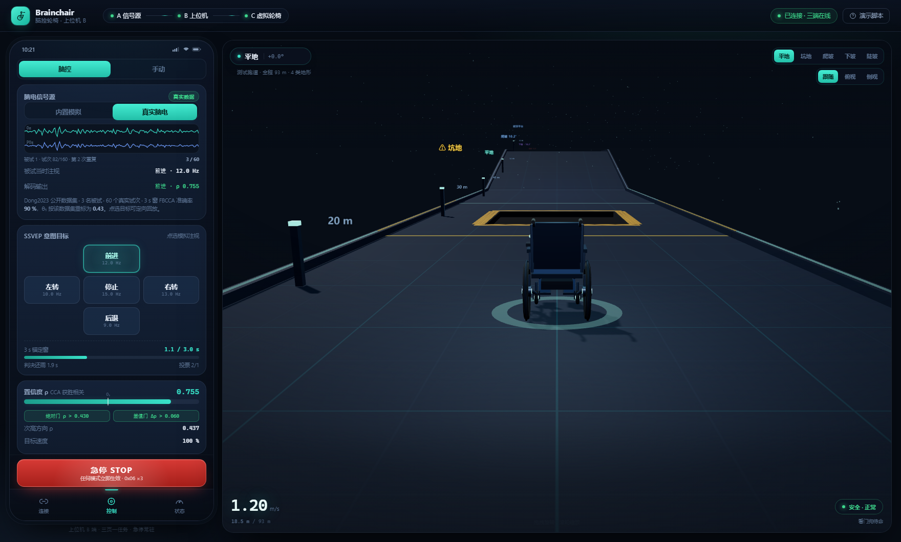

# Brainchair 上位机 B · UI + 3D 场景原型

按仓库里**已提交的文档**（PRD / handover v1.4 / system-architecture / udp-protocol）做的一套可运行原型：
左边是 B 端上位机 App 的三页界面，右边是把**轮椅建模**与**场景建模**放在同一个坐标系里跑起来的 3D 执行端。

它是两件事的合体：

- 给 UI 负责人一份**能点的**界面（不是线框图），色值直接取自 A 端 `colors.xml`；
- 给场景/Unity 负责人一份**能跑的规则样本**——跑道分段、坡度姿态、坑地停车、看门狗，全部按文档里的数值实现，可以直接对着抄进 Unity。



> 左：B 端上位机界面（当前停在控制页）；右：同一坐标系里的 3D 执行端——测试跑道、坑地、坡道，以及纯代码建模的轮椅。

---

## 怎么跑

**Windows 上最省事：双击 `start.bat`**，它起好服务并自动开浏览器。

或者手动：

```bash
cd brainchair-ui
python -m http.server 8000
# 浏览器打开 http://localhost:8000
```

必须起本地 http 服务：页面用了 ES module + importmap，`file://` 直接打开会被浏览器拦住。

**离线可用。** `vendor/three.module.js` 已经落盘（r160，1.2 MB），答辩现场没有网络也能跑。

**想直接看真实脑电驱动**：打开 `index.html?src=real`，或在控制页顶部把信号源切到「真实脑电」。

---

## 真实脑电：信号从哪来、怎么变成轮椅动作

默认那个「A 端降质滑块」合成的是 ρ 曲线 —— 规则是真的，信号是编的。
控制页顶部多了一个 **信号源** 开关，切到「真实脑电」后，喂给状态机的每个判定窗都来自
一份**公开的真人脑电记录**，解码也是真的算出来的。

### 数据来源

| 项 | 值 |
|---|---|
| 数据集 | Dong2023 · 59 被试 40 类 SSVEP（NEMAR `nm000128`） |
| 论文 | Dong & Tian, *A large database towards user-friendly SSVEP-based BCI*, **Brain Science Advances** 9(4):297–309, 2023 |
| DOI | `10.26599/BSA.2023.9050020`（数据 DOI `10.82901/nemar.nm000128`） |
| 许可 | **CC BY-NC 4.0** —— 非商用，需署名。仓库里不放原始文件，只放 39 KB 的派生结果 |
| 采集 | NeuSenW (Neuracle) · 8 导联全在枕区（POz PO3 PO4 PO7 PO8 Oz O1 O2）· 250 Hz · 参考 Fp1 |
| 刺激 | 8.0–15.8 Hz、步进 0.2 Hz、JFPM、单试次 4 s、每类 4 次 |
| 本系统用到的被试 | 1 / 2 / 3（各 20 个试次，共 60 窗） |

选它是因为：**直链可下、不用注册、单被试只有 6.9 MB、8 个导联全在枕区**，
而且范式就是 SSVEP —— 与 PRD 里的 5 目标界面同一套原理，不用改界面语言。

### 流水线

```
tools/fetch_data.py          下 3 个被试的 .set（各 6.9 MB）到 tools/raw/（不入库）
        ↓
tools/decode_ssvep.py        50 Hz 陷波 + 6–40 Hz 带通 → 逐试次切 3 s 窗
                             → FBCCA 判类 → 单频带 CCA 取 ρ → 标定 θ₁ / θ₂
        ↓
data/eeg-track.json          60 个判定窗 + 2 导 × 3 s 波形缩略（int8，base64）
data/decode-report.md        准确率、ρ 分布、阈值扫描表
        ↓
js/eegreal.js                前端按 4 s 节拍取下一窗，把 ρ / ρ₂ / 类别交给原有状态机
```

**关键点：前端不做信号处理。** 判类和相关值都在离线阶段算完，界面只负责按节拍回放 ——
这样答辩时问「你这个 ρ 怎么来的」，答案是能追到具体一行 Python 和具体一个试次。

### 结果（3 被试 / 60 试次 / 5 类 / 3 s 窗）

| 指令 | 刺激频率 | 准确率 |
|---|---|---|
| 前进 | 12.0 Hz | 12/12 · 100 % |
| 左转 | 10.0 Hz | 11/12 · 92 % |
| 停止 | 15.0 Hz | 12/12 · 100 % |
| 右转 | 13.0 Hz | 7/12 · **58 %** |
| 后退 | 9.0 Hz | 12/12 · 100 % |
| **合计** | | **90.0 %** |

「右转」明显偏弱 —— 三个被试里有两人在 13 Hz 上几乎没有响应（8 导联、儿童被试，
个体差异本来就大）。这不是代码 bug，`decode-report.md` 里有逐试次的 ρ 对照。

### 双门控在真实数据上的表现

| θ₁ | 通过率 | **通过者**准确率 |
|---|---|---|
| 0.40 | 75 % | 100 % |
| **0.43（标定值）** | **72 %** | **100 %** |
| 0.55 | 50 % | 100 % |
| 0.63（文档值） | 27 % | 100 % |

标定后 **θ₁ = 0.43、θ₂ = 0.06**（脚本按「已知误判全拦住 + 留余量」自动算，换数据会自己变）。

两件事值得在答辩时讲：

1. **6 次误判的 Δρ 全部 ≤ 0.023** —— 也就是「两个类分不清」的情况，差值门一次不漏地拦住了。
   这是双门控设计意图的直接证据。
2. **宁可拒识，不可判错。** 72 % 通过意味着每四个窗就有一个被拒 —— 界面上表现为**停车**，
   而不是**走错方向**。被拒的 17 个窗里有 11 个其实判对了，只是没敢确认。

> 文档里的 θ₁=0.63 是给我方接收机（另一套滤波器、导联、参考）标定的。
> CCA 相关值的绝对刻度随预处理和导联数变化，**换数据源必须重标**。
> 两套数字不能直接比，这点要说清楚，别硬凑。

### 复现

```bash
python tools/fetch_data.py --subjects 1 2 3      # 约 21 MB
python tools/decode_ssvep.py --subjects 1 2 3    # 重新生成 data/ 下两个文件
```

### 界面里能看到的

- 两导（Oz / POz）**真实波形**，采样点直接来自 `.set`，不是画出来的
- 「被试当时注视」与「解码输出」并排显示 —— 判错的时候会当场显出来，不藏
- 窗口计数 `n / 60`，点任意目标可**定向回放**该类真实试次（便于逐个动作演示）

---

## 文件

| 文件 | 作用 |
|---|---|
| `index.html` | 手机三页（连接 / 控制 / 状态）+ 3D 舞台 + 演示脚本弹窗 |
| `css/style.css` | 全部视觉。主色 `#38E1C8`、底 `#0B1220`、卡片 `#16233A`，与 A 端 `colors.xml` 一致 |
| `js/rules.js` | 规则常量、CRC-32、B→C 24 字节指令帧编码 |
| `js/scene3d.js` | 跑道地形、轮椅程序化建模、三种相机、光照 |
| `js/app.js` | 状态机（脑机帧 / 锚定窗 / 双门控 / 看门狗 / 急停）、交互、日志 |
| `js/eegreal.js` | 真实脑电回放源：读 `data/eeg-track.json`，按 4 s 节拍喂判决、画波形 |
| `data/eeg-track.json` | 从公开数据集解码出的 60 个真实判定窗（含波形缩略，39 KB） |
| `data/decode-report.md` | 准确率、相关值分布、阈值标定过程（脚本自动生成） |
| `tools/fetch_data.py` | 下载公开数据集被试数据（NEMAR 直链，无需注册） |
| `tools/decode_ssvep.py` | CCA / FBCCA 解码、阈值标定、导出上面两个文件 |
| `vendor/three.module.js` | Three.js r160，本地副本 |

---

## 界面对应哪条需求

| 界面元素 | 依据 |
|---|---|
| 三页分离（连接 / 控制 / 状态），一页一任务 | PRD「Look & Feel」 |
| 急停按钮常驻在 tab 栏上方，三页都点得到 | PRD「急停按钮醒目红色，任何页面可用」 |
| 脑控 / 手动双模式 + 优先级 急停 > 手动 > 脑控 | FR-02、Business Rules |
| 5 个 SSVEP 目标带闪烁动画与频率标注（12.00 / 8.57 / 6.67 / 5.45 Hz） | FR-01 |
| 3 s 锚定窗进度条 + 「下一窗 4.0 s」 | handover v1.4 §2.4 决策节拍 |
| ρ 大数字 + θ₁ 刻度线 + 双门控状态灯 | handover §7.2 双门控 |
| 意图切换 3 帧确认 | PRD「意图切换确认」 |
| 手动接管后信号接收关闭、30 s 自动恢复 | FR-02「手动接管」 |
| 断链 1 s 看门狗 | FR-03、system-architecture §4.3 |
| 24 字节指令帧十六进制实时显示 | system-architecture §4.1 |

---

## 3D 场景对应哪条需求

一条 93 m 的测试跑道，按 FR-03 把四类地形串起来：

| 区段 | z 范围 | 高差 | 坡度 | 规则 |
|---|---|---|---|---|
| 平地 | 0 – 25 | 0 | 0° | — |
| 坑地 | 25 – 35（坑口 27.6 – 31.6） | −0.18 m | 0° | 车头进入坑沿 → 立即停车，后退可解除 |
| 平地 | 35 – 45 | 0 | 0° | — |
| 爬坡 | 45 – 58 | +2.34 m | 10.2° | 正常通行，车身随坡度俯仰 |
| 坡顶平台 | 58 – 64 | — | 0° | — |
| 下坡 | 64 – 77 | −2.34 m | −10.2° | 限速 0.55 m/s |
| 终点平地 | 77 – 86 | 0 | 0° | — |
| 陡坡 | 86 – 93 | +2.27 m | 18.0° | 超过 15° 限值 → 停车 |

轮椅是纯代码建模，没有外部模型文件：后轮（胎面 / 轮辐 / 手推圈 / 轴盖）、前万向轮（叉架 + 转向）、车架管件、坐垫、靠背、扶手、控制器与摇杆、脚踏、电池包。轮子按 `v·dt/R` 滚动，车身按坡度做俯仰，转向时轻微侧倾。

---

## 规则常量（改这里就够了）

全部集中在 `js/rules.js` 的 `RULES`：

| 常量 | 值 | 出处 |
|---|---|---|
| `THETA1` | 0.63 | handover §7.2 绝对门 |
| `THETA2` | 0.171 | handover §7.2 差值门 |
| `WINDOW_SEC` / `CYCLE_SEC` | 3.0 / 4.0 | §2.4 锚定窗与节拍 |
| `VOTE_N` | 1（演示取首窗采纳） | §2.4 投票，3 窗≈12 s 演示太慢 |
| `WATCHDOG_MS` | 1000 | FR-03 |
| `ESTOP_BURST` / 间隔 | 3 次 / 100 ms | FR-02 |
| `MANUAL_RESUME_MS` | 30000 | FR-02 |
| `SLOPE_LIMIT_DEG` | 15 | FR-03 |
| `DOWNHILL_LIMIT` | 0.55 m/s | FR-03 |
| `SPEED_MAX` | 1.2 m/s（对应 ρ=0.74） | §7.2 方向窗平均相关 |

**ρ 的可调性**：控制页底部「A 端信号模拟」滑块按 `ρ = 0.30 + 0.44·(c/100)^1.9` 换算，100 % → 0.740、0 % → 0.30，76 % 附近跌破静息段最高相关 0.578（对应文档里的「翻转点 ≈76 %」）。这条曲线只用于演示「拒识」，真机阈值必须按 `receiver-handbook` §5.6 重标。

---

## 搬到 Unity 时怎么对

| 这份原型 | Unity 里 |
|---|---|
| `SEGMENTS` 表 + `heightAt(z)` / `slopeRadAt(z)` | 同一个分段线性函数；地形用 ProBuilder 或按函数生成 mesh。别用 Terrain，坡口会圆 |
| `buildChair()` 的一堆基本体 | 换成你们的轮椅 FBX，只要保证 `+Z` 朝前、原点在轮胎接地点 |
| `wheel.rotation.x += speed*dt/0.281` | `WheelCollider` 或直接转 Transform（演示项目直接转更稳） |
| `_updateCamera()` 三种模式 | 挂一个 CameraRig，Follow / Top / Side 三个偏移量 |
| `decide()` / `issue()` / `evaluateSafety()` | 一比一翻成 C#，没有 Unity API 依赖 |
| `buildCommandFrame()` | 收包用 `UdpClient` + 后台线程入 `ConcurrentQueue`，`Update()` 里出队；**别在后台线程动 Transform** |
| `heartbeat()` 2 Hz | 指令没变也要发，C 端只记「最近一条」 |

`app.js` 里的运动学只有三个状态量：`z`（沿跑道）、`x`（横向）、`yaw`（朝向）。Unity 侧用 `transform.position` / `rotation` 就够了，不需要物理引擎。

---

## 已知限制（答辩要能说清）

1. **没有真 UDP。** 指令帧是真的按 24 B 布局编码、CRC 是真算的，但没有发出去。接 A 端时把 `brainFrame()` 换成收包解析即可，后面整条链路不用改。**注意**：A 端走的是自采 62 导联，和本文用的公开数据集不是一套硬件。
2. **阈值是近似刻度。** 内置模拟那条 ρ(c) 曲线是按文档端点拟合的，不是实测标定值。
3. **指令编号用了两套来源。** 0 停 / 1 前 / 2 左 / 3 右 / 4 后 取自 `system-architecture` §3；急停 `0x06` 取自 PRD FR-02（该文档的指令帧里没有 0x06 位）。两处文档本身不一致，`rules.js` 里已注明。
4. **ρ 在「停」时固定约 0.49。** 真实系统里静息段的获胜相关是 0.5 上下浮动，这里做了简化。
5. **真实数据只有 3 个被试。** 90 % 是这 3 人的成绩，**不能外推到全体**（原数据集有 59 人，全部下载约 400 MB，脚本支持 `--subjects` 指定）。同理，θ₁ / θ₂ 是在这 60 个窗上标定的，样本量小，换人换设备都要重跑标定。
6. **真实脑电不是"实时"。** 是逐窗回放已经解码好的结果，延迟为 0、丢包为 0 —— 真机上的抖动、重传、时钟漂移在这套里都看不到。这一点别在答辩时说成"在线系统"。

---

## 演示动线（3 分钟）

见界面右上角「演示脚本」按钮，里面是六步走法 + 规则映射表，答辩时可以直接照着念。

**加了真实脑电之后，建议这样安排**：

| 时间 | 做法 | 讲什么 |
|---|---|---|
| 0:00–0:40 | 默认（内置模拟），点「前进」等 3 s | 三页界面 + 双门控 + ρ 与 θ₁ 的关系 |
| 0:40–1:40 | 切「真实脑电」，让它跑两三个窗 | 波形是真的、判类是真的、ρ 是真的；顺带指出偶发判错 |
| 1:40–2:10 | 点「右转」定向回放 | 13 Hz 那 58 % 准确率，个体差异 |
| 2:10–2:40 | 拖降质滑块到 60 % | 拒识 → 停车而不是走错方向 |
| 2:40–3:00 | 按急停，再解锁 | 急停三页可用、连发 3 次锁止 |

一句话总结可以这么说：**"我们用公开的真人脑电跑通了从信号到轮椅动作的整条链路，
90 % 的时间判对方向，判不准的窗一律停车 —— 这是设计，不是缺陷。"**
