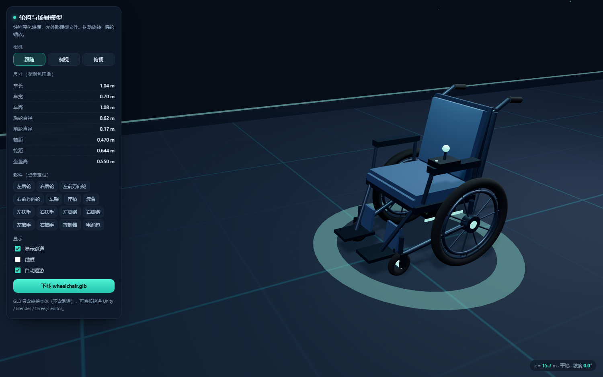

# scene-model · 轮椅与测试场景

B 端上位机里那台轮椅和那条 93 m 跑道，单独抽出来的可复用包。

**纯程序化建模**：没有一个 `.obj` / `.gltf` / 贴图文件，全部由代码按尺寸参数生成。
改一个常量就能改车身比例，不需要回去开建模软件。

| 能给你什么 | 在哪 |
|---|---|
| 3D 轮椅（15 个具名部件，8620 三角面） | `wheelchair.js` → `buildWheelchair()` |
| 可直接拖进 Unity / Blender 的网格 | `wheelchair.glb`（442 KB） |
| 每个部件的精确尺寸 | `dimensions.json`、`WHEELCHAIR_SPEC` |
| 93 m 测试跑道 + 地形高度/坡度函数 | `track.js` → `heightAt()` / `slopeRadAt()` |
| 浏览器里看模型、量尺寸 | `viewer.html` |



---

## 30 秒接入

页面里先有 importmap（`three` 指向本目录自带的 r160）：

```html
<script type="importmap">
{ "imports": { "three": "./vendor/three.module.js" } }
</script>
```

只要轮椅：

```js
import * as THREE from 'three';
import { buildWheelchair, makeMaterials } from './scene-model/index.js';

const scene = new THREE.Scene();
const { group, parts } = buildWheelchair(makeMaterials());
scene.add(group);            // 原点在「地面 · 两后轮轴心中点」，直接落在地上
```

只要地形数据（做导航、判决、碰撞都不用加载 3D）：

```js
import { heightAt, slopeRadAt, zoneAt, pitAt, TRACK_LEN } from './scene-model/index.js';

heightAt(50);      // → 0.96   z=50 m 处的路面高度
slopeRadAt(50);    // → 0.178 rad ≈ 10.2°
zoneAt(50).name;   // → '爬坡 10.2°'
pitAt(29);         // → { z0, z1, x0, x1, depth: 0.18 }
```

整条链路（渲染器 + 光照 + 跟随相机）一起用：

```js
import { World } from './scene-model/index.js';

const world = new World(canvas);
world.update(dt, { z, x, yaw, speed, steer, yawRate, estop });
world.render();
```

---

## 坐标系与单位

| 项 | 值 |
|---|---|
| 单位 | **米**（1 unit = 1 m） |
| 手性 | 右手系（与 Three.js / glTF 一致） |
| 前进 | **+Z** |
| 向上 | **+Y** |
| 驾驶员左手侧 | **+X** |
| 原点 | **地面**，两后轮轴心连线的中点正下方 |

因为原点在地面，`group.position.y` 直接等于路面高度，不需要再减半车高：

```js
group.position.set(x, heightAt(z), z);
group.rotation.y = yaw;
group.rotation.order = 'YXZ';   // 先偏航后俯仰，否则上坡转向会歪
group.rotation.x = -slopeRadAt(z);
```

---

## 尺寸（实测包围盒，`dimensions.json` 同源）

| 项 | 值 |
|---|---|
| 车长（Z） | 1.037 m |
| 车宽（X） | 0.702 m |
| 车高（Y） | 1.084 m |
| 后轮直径 | 0.620 m（胎面外缘） |
| 前轮直径 | 0.166 m |
| 轴距 | 0.470 m |
| 轮距 | 0.644 m |
| 坐垫高 | 0.550 m |
| 整车质量 | 未建模（占位 `—`，需要的话自己填） |

> 后轮半径 `radius = 0.281` 是**胎面中线**，外缘是 `0.310`；
> 轴心高度按外缘算（`axleY = 0.310`），所以轮子刚好贴地、不下陷也不悬空。
> 前万向轮同理：转向轴 0.160 − 胎面外缘 0.083 = 轮心落差 0.077。

---

## 部件与动画

`buildWheelchair()` 返回的 `parts` 里全是具名 `Group`，可以直接 `getObjectByName()` 或按 key 取：

| key | 内容 | 需要你驱动的动画 |
|---|---|---|
| `rearWheelL` / `rearWheelR` | 轮胎、轮圈、轮毂、10 根辐条、手推圈 | 绕自身 **X** 轴，ω = v / 0.281 rad/s |
| `casterL` / `casterR` | 转向轴 + 叉架（`fork`）+ 轮（`casterWheel`） | 绕 **Y** 轴转 = `steer`；轮子绕 X 轴，转速取后轮 × 3.4 |
| `frame` | 4 根车架管 | — |
| `seat` | 座框 + 坐垫 + 前缘 | — |
| `backrest` | 靠背（后倾 9.2°）+ 顶管 + 立柱 | — |
| `armrestL` / `armrestR` | 扶手垫 + 两根支撑 | — |
| `footrestL` / `footrestR` | 吊架 + 踏板 + 小腿挡板 | — |
| `pushHandleL` / `pushHandleR` | 推手（含握把） | — |
| `controller` | 外壳 + 摇杆 + 摇杆球 + 指示灯 | 可让摇杆随 steer 摆动 |
| `battery` | 电池包 + 发光条 | — |

整车姿态：绕 X 轴 `−坡度`，车身转向侧倾 `−yawRate × 0.028`。

---

## 地形

`SEGMENTS` 是唯一数据源，改动它会同时影响渲染、高度查询和 `pitAt()`：

| # | id | z 范围 | 高差 | 名称 |
|---|---|---|---|---|
| 1 | `flat` | 0 – 25 | 0 | 平地 |
| 2 | `pit` | 25 – 35 | 0 | 坑地（27.6–31.6 m 处 0.18 m 深、3.8 m 宽） |
| 3 | `flat2` | 35 – 45 | 0 | 平地 |
| 4 | `up` | 45 – 58 | +2.34 | 爬坡 10.2° |
| 5 | `top` | 58 – 64 | 0 | 坡顶平台 |
| 6 | `down` | 64 – 77 | −2.34 | 下坡 −10.2° |
| 7 | `flat3` | 77 – 86 | 0 | 终点平地 |
| 8 | `steep` | 86 – 93 | +2.27 | 陡坡 18.0° |

---

## 给 Unity 组员

`wheelchair.glb` 已经导好了，`Assets` 里拖进去即可：

- **缩放**：文件按米建，导入时 Scale Factor 保持 1，别改。
- **原点**：在两后轮轴心的地面投影点，所以 `transform.position.y = 0` 就是站在地面上。
- **手性**：glTF 是右手系，Unity 导入时会自动翻 X 轴。也就是说这份模型在 Unity 里
  `+X` 会变成**驾驶员右侧**，写左右对称逻辑（比如左右轮差速）时注意一下。
- **材质**：纯色 PBR（金属度/粗糙度都烘进去了），没有贴图，也没有骨骼和动画——
  轮子转动、前轮转向得按上表的公式自己写。
- **不要**拿它当碰撞体，太细；用 Capsule / Box 拼一个简化的更省。

需要改尺寸就改 `wheelchair.js` 顶部的 `R` / `TUBE` 或 `WHEELCHAIR_SPEC`，然后重新导出。

---

## 重新生成 GLB

改了模型之后：

```bash
cd scene-model
npm init -y && npm i three@0.160.0     # 一次性，node_modules 不入库
node tools/export-glb.mjs              # 覆盖 wheelchair.glb 与 dimensions.json
```

脚本走 Node + `GLTFExporter`，没有 DOM，所以材质用纯色（不导贴图）。
`package.json` / `node_modules` 已经在 `.gitignore` 里。

---

## 看模型

```bash
python -m http.server 8000      # 在仓库根目录或 brainchair-ui 目录下都行
# 打开 http://localhost:8000/scene-model/viewer.html
```

页面里可以拖动旋转、滚轮缩放、切三种相机、点部件名高亮定位、切线框、看实测尺寸。
`?frames=200` 会跑 200 帧后停住，方便无头截图。

---

## 依赖

- Three.js **r160**，`vendor/three.module.js` 自带一份（MIT）。
  本目录是自足的：拷走整个 `scene-model/` 就能跑，不用管 `host-app/`。
- 与 `brainchair-ui/`（B 端上位机）共用同一份代码：那边的 `js/scene3d.js`
  只有一行 `export * from '../../scene-model/index.js'`，不存在两份会走样的副本。
